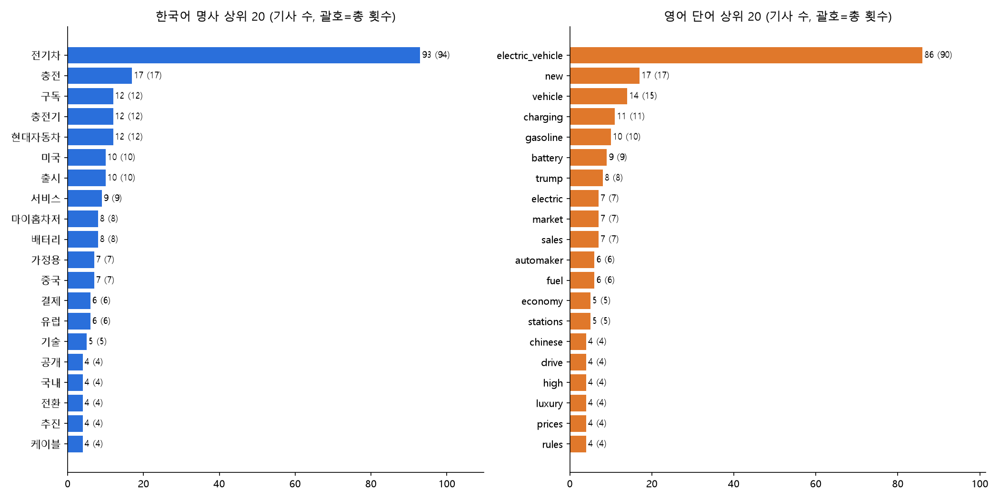
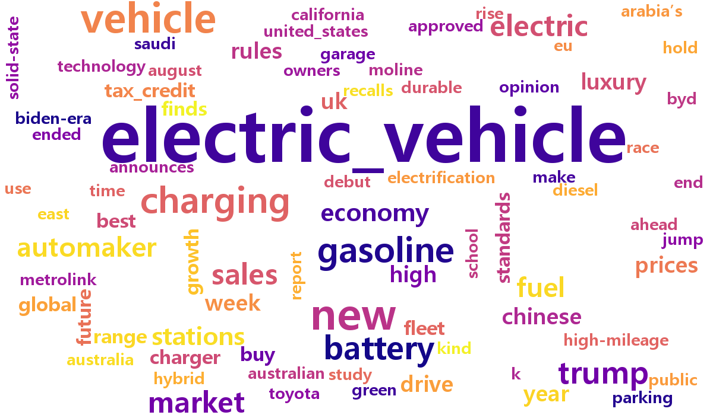
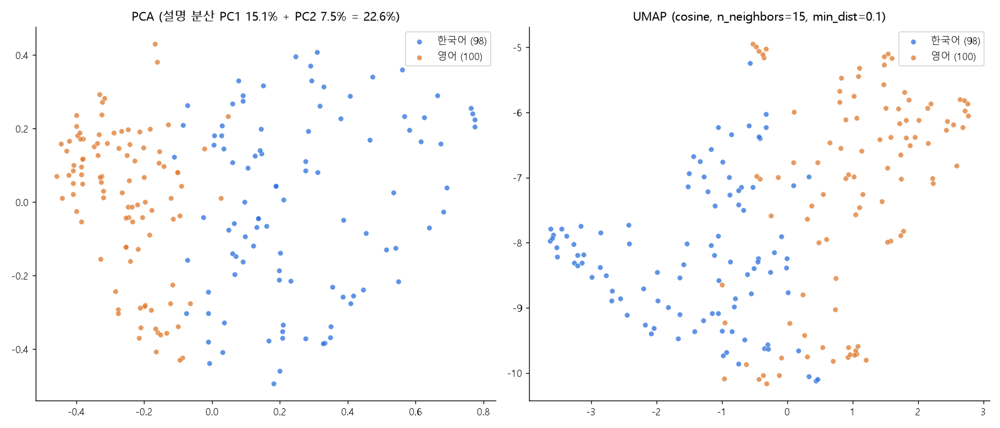

# 전기차 뉴스 수집·전처리·임베딩 실습

Google 뉴스 RSS에서 최근 30일의 전기차 뉴스를 한국어와 영어로 각각 수집하고, 정제·형태소 분석·동의어 정규화·단어 빈도 집계를 거쳐 문장 임베딩(PCA, UMAP 시각화)까지 진행한 과정을 기록한 문서입니다.

수집 시점은 2026-10-01이고, 최종 데이터는 한국어 98건과 영어 100건, 합계 198건입니다.

## 목차

1. [전체 흐름](#1-전체-흐름)
2. [데이터 수집](#2-데이터-수집)
3. [데이터 확인과 정제](#3-데이터-확인과-정제)
4. [매체명 표준화](#4-매체명-표준화)
5. [한국어 형태소 분석과 사용자 사전](#5-한국어-형태소-분석과-사용자-사전)
6. [동의어 사전과 정규화](#6-동의어-사전과-정규화)
7. [영어 토큰화](#7-영어-토큰화)
8. [단어 빈도 집계와 시각화](#8-단어-빈도-집계와-시각화)
9. [특정 단어가 나온 기사](#9-특정-단어가-나온-기사)
10. [문장 임베딩](#10-문장-임베딩)
11. [임베딩으로 기사 검색](#11-임베딩으로-기사-검색)
12. [차원 축소: PCA와 UMAP](#12-차원-축소-pca와-umap)
13. [한계와 유의할 점](#13-한계와-유의할-점)
14. [파일 목록](#14-파일-목록)
15. [실행 환경과 재현 방법](#15-실행-환경과-재현-방법)

## 1. 전체 흐름

```
Google 뉴스 RSS ─ 수집 ─ 결측·중복 확인 ─ HTML·공백·매체명 정리 ─ 매체명 표준화
      │
      ├─ 한국어: Kiwi 형태소 분석 ─ 사용자 사전 ─ 동의어 정규화 ─┐
      └─ 영어: 소문자·단어 분리 ─ 동의어 정규화 ──────────────────┤
                                                                  ├─ 단어 빈도 ─ 막대그래프·워드클라우드
                                                                  └─ 기사 목록 검수
문장 임베딩(다국어 모델) ─ 유사도 검색 ─ PCA·UMAP 2차원 시각화
```

| 단계 | 입력 | 출력 | 스크립트 |
|---|---|---|---|
| 수집 | RSS | `ev_news.csv` (200건) | `collect_news.py` |
| 정제 | `ev_news_raw.csv` | `ev_news.csv` (198건) | `clean_news.py` |
| 매체명 보완 | 도메인으로 표시된 매체 | `media_resolved.json` | `resolve_media.py`, `resolve2.py` |
| 정규화 | 제목 | `ev_news_norm.csv`, `ev_news_review.csv` | `normalize.py` |
| 단어 집계 | 정규화된 제목 | 상위 단어 표 | `top_words.py` |
| 시각화 | 집계 결과 | 그래프 PNG | `charts.py` |
| 임베딩 | 정리 제목 | `title_embeddings.npy` | `embed.py` |
| 차원 축소 | 임베딩 | PCA·UMAP 좌표와 그림 | `pca_plot.py`, `umap_compare.py`, `static_plots.py` |

## 2. 데이터 수집

Google 뉴스 RSS 검색 주소에 검색어를 넣어 최근 30일 기사를 수집했습니다.

| 항목 | 한국어 | 영어 |
|---|---|---|
| 검색어 | `전기차` | `electric vehicle` |
| 지역·언어 옵션 | `hl=ko&gl=KR&ceid=KR:ko` | `hl=en-US&gl=US&ceid=US:en` |
| 기간 | `when:30d`로 검색한 뒤 발행일도 한 번 더 확인 | 동일 |
| 최대 수집 건수 | 100건 | 100건 |
| 수집된 건수 | 100건 | 100건 |

저장한 항목은 제목, 발행일, 매체, 링크, 수집시각입니다. CSV는 엑셀에서 한글이 깨지지 않도록 UTF-8(BOM)로 저장했습니다.

**데이터 형태** (pandas로 읽었을 때)

| 열 | 타입 | 설명 |
|---|---|---|
| 언어 | object | ko / en |
| 제목 | object | 기사 제목 |
| 발행일 | datetime64 | 로컬 시간 기준 |
| 매체 | object | 언론사 |
| 링크 | object | Google 뉴스 리다이렉트 주소(원문 주소가 아님) |
| 수집시각 | datetime64 | 수집 실행 시각, 모든 행이 같은 값 |

원본은 200행 × 6열입니다.

## 3. 데이터 확인과 정제

### 3.1 점검 결과

| 점검 | 결과 |
|---|---|
| 제목·링크 결측, 발행일 변환 실패 | 0건 (제외된 기사 없음) |
| 제목에 HTML 문자·태그·불필요한 공백 | 0건 (바뀐 제목 없음) |
| 제목 끝의 ` - 매체명`이 `매체` 열과 일치하는지 | 200건 모두 일치, 전부 제거 |
| 제목과 매체가 모두 같은 중복 | 3건 중 2건 제거 |
| 링크 중복 | 0건 |

중복으로 제거한 제목은 `[아프리카 녹색전환] ②"소리 없이 바뀐다"…현지서 본 전기차 혁명`(v.daum.net)입니다. 발행일이 07:02:15, 07:02:00, 07:02:15인 3건 중 가장 먼저 나온 행을 남겼습니다.

결과는 200건에서 198건(한국어 98건, 영어 100건)이 되었습니다.

### 3.2 제목은 같지만 매체가 다른 기사

같은 기사를 여러 매체가 전재한 경우로 보여 중복으로 보지 않고 남겼습니다.

| 제목 | 매체 |
|---|---|
| 스페인, 회생전력으로 전기차 충전…"국내서도 재활용해야" | 연합뉴스TV, 연합뉴스 |
| [아프리카 녹색전환] ②"소리 없이 바뀐다"…현지서 본 전기차 혁명 | 연합뉴스, 중도일보 (v.daum.net) |
| One year after the end of the EV tax credit, is the future still electric? | NPR, kasu.org |

## 4. 매체명 표준화

### 4.1 조선비즈

`Chosunbiz` 3건을 `조선 비즈`로 통일했습니다. `조선일보` 3건은 다른 언론사라서 그대로 두었습니다.

### 4.2 도메인으로 적힌 매체

`매체` 열에 `v.daum.net`, `cnbc.com`처럼 도메인이 적힌 33건 중 22건은 기사에 접근해 사이트명을 확인해 채웠습니다. Google 뉴스 링크를 원문 주소로 풀어서 기사 페이지의 사이트명 메타정보를 읽었습니다.

| 원래 값 | 채운 값 | 비고 |
|---|---|---|
| v.daum.net | 중도일보, 연합뉴스 | Daum 안에 표시된 원 매체명 |
| news.jtbc.co.kr | JTBC 뉴스 | |
| theguru.co.kr | 더구루 | 본문 서두의 `[더구루=…]` 표기로 확인 |
| newstree.kr | 뉴스트리 | 메타정보는 `뉴스;트리(주)` |
| news.einfomax.co.kr | 연합인포맥스 | |
| zdnet.co.kr | ZDNet Korea | |
| m-i.kr | 매일일보 | |
| carnewschina.com | CarNewsChina | |
| nbcchicago.com | NBC Chicago | |
| EVChargingStations.com | EV Charging Stations | |
| ky3.com | KY3 | 메타정보가 주소 형태 |
| NYC.gov | City of New York | |
| columbiaspectator.com | Columbia Daily Spectator | |
| Euronews.com | Euronews | |
| cnbc.com | CNBC | |
| markets.businessinsider.com | Business Insider | |
| Motor1.com | Motor1 | 사이트명 메타가 없어 접속한 도메인 기준 |
| kasu.org | KASU | |
| vcreporter.com | VC Reporter | |

접근이 막혀(HTTP 401/403/406/429) 확인하지 못한 7건은 도메인을 그대로 두었습니다. 접근 제한을 우회하지는 않았습니다.

`wsj.com`, `vtcng.com`, `thetruthaboutcars.com`, `CBS17.com`, `cbs19.tv`, `fox43.com`, `MLive.com`

`Department of Energy (.gov)`처럼 공백이 있는 기관명은 도메인이 아니라고 보고 건드리지 않았습니다.

## 5. 한국어 형태소 분석과 사용자 사전

한국어 제목은 [Kiwi](https://github.com/bab2min/kiwipiepy)(`kiwipiepy`)로 분석했습니다.

### 5.1 공백 분리와 형태소 분석 비교

| 원문 | 공백 분리 | 형태소 분석 |
|---|---|---|
| 전기차 충전요금, 가을철 주말 낮시간 '최대 32%' 할인 | `충전요금,` `'최대` `32%'` 처럼 구두점이 붙음 | 전기/NNG 차/NNG 충전/NNG 요금/NNG `,`/SP … 32/SN %/SW |
| 전기차 대신 휘발유차 사라…트럼프 행정부, 연비규제 대폭 완화 | `사라…트럼프` 가 한 덩어리 | … 사/VV 라/EC …/SE 트럼프/NNP 행정부/NNG … |
| "꽂기만 하면 충전·결제 끝"…기후부, 전기차 PnC 기술 검증 | `끝"…기후부,` 가 한 덩어리 | 꽂/VV 기/ETN 만/JX 하/VX 면/EC … 기후/NNG 부/NNG … |

- 공백 분리는 구두점이 단어에 붙고, 문장 요소가 붙은 어절을 나누지 못합니다.
- 형태소 분석은 용언의 어간과 어미, 조사를 구분합니다.
- 기본 사전에서는 `전기차`가 `전기`+`차`로 쪼개지고, `사라`도 `사`+`라`로 잘못 잘렸습니다.

### 5.2 사용자 사전 (`user_dict.txt`)

복합어가 쪼개지지 않도록 기업명·제품명·업계 용어를 등록했습니다. 후보는 Kiwi가 명사 둘 이상으로 쪼갠 복합어와 붙어서 나오는 명사 쌍에서 골랐습니다.

| 구분 | 단어 |
|---|---|
| 요청한 단어 | 전기차, LG엔솔, 엔솔 |
| 기업·제품명 | LG에너지솔루션, 삼성SDI, K-배터리, 마이홈차저, V2G, 기후부, 현대자동차그룹, 현대차그룹, 현대차 |
| 배터리·소재 | 폐배터리, 배터리셀, 원통형, 양극재 |
| 차종 | 휘발유차, 경유차, 기름차, 완성차업계 |
| 충전·정책 | 충전요금, 공공충전기, 급속충전, 연비규제, 생산세액공제, 회생전력, 녹색전환, 퇴직연금 |
| 접미 결합 | 의무화, 가정용 |
| 표기 변형 | 전기자동차, 전기승용차, 배터리전기차, 이차전지, 가솔린 |

### 5.3 적용 전후

| 문장 | 적용 전 | 적용 후 |
|---|---|---|
| LG엔솔, 전기차를 공급 | LG 에 ᆫ 솔 , 전기 차 를 공급 | LG엔솔 , 전기차 를 공급 |
| LG에너지솔루션 … 원통형 배터리셀 공급 | LG 에너지 솔루션 … 원통 형 배터리 셀 | LG에너지솔루션 … 원통형 배터리셀 |
| 전기차 폐배터리 회수율 65.9% | 전기 차 폐 배터리 회수 율 | 전기차 폐배터리 회수 율 |
| 전기차 대신 휘발유차 사라… | 전기 차 … 휘발유 차 사 라 | 전기차 … 휘발유차 사라 |

전체 제목 기준으로 `전기차`는 한 토큰으로 94번 나오고, 낱개 `전기`는 97번에서 2번, `차`는 102번에서 5번으로 줄었습니다.

## 6. 동의어 사전과 정규화

같은 뜻인데 표기가 다른 표현을 대표어 하나로 모아 집계가 갈라지지 않게 했습니다. 규칙은 `synonyms.csv`에서 관리하고, `normalize.py`가 긴 표현부터 치환합니다.

### 6.1 전기차를 가리키는 표현

한국어는 변형이 없었습니다(98건 모두 `전기차`). 영어에서만 6가지 표현을 `electric_vehicle` 하나로 합쳤습니다.

| 원 표현 | 횟수 | 대표어 |
|---|---|---|
| ev | 33 | electric_vehicle |
| electric vehicle | 29 | electric_vehicle |
| electric cars | 9 | electric_vehicle |
| electric vehicles | 8 | electric_vehicle |
| electric car | 7 | electric_vehicle |
| evs | 7 | electric_vehicle |

한국어에서 미래에 나올 수 있는 `전기자동차`, `전기 자동차`, `전기승용차`, `배터리전기차`, `이브이`, `BEV`는 데이터에 없었지만 선제 등록했습니다.

### 6.2 그 밖의 같은 의미 표현

| 언어 | 그룹 | 원 표현 → 대표어 | 횟수 |
|---|---|---|---|
| 한국어 | 현대자동차 | 현대차 → 현대자동차 | 13 |
| 한국어 | 현대자동차그룹 | 현대차그룹 → 현대자동차그룹 | 2 |
| 한국어 | 미국 | 美 → 미국 | 7 |
| 한국어 | 중국 | 中 → 중국 | 3 |
| 한국어 | 일본 | 日 → 일본 | 2 |
| 한국어 | 한국 | 韓 → 한국 | 1 |
| 한국어 | LG에너지솔루션 | LG엔솔 → LG에너지솔루션 | 1 |
| 한국어 | 자동차 | 차량 → 자동차 | 1 |
| 영어 | gasoline | gas, petrol → gasoline | 6 + 4 |
| 영어 | automaker | automakers, carmakers, carmaker → automaker | 4 + 1 + 1 |
| 영어 | vehicle | car(s), vehicles → vehicle | 11 + 15 + 13 |
| 영어 | battery | batteries → battery | 4 |
| 영어 | tax_credit | tax credit(s) → tax_credit | 2 + 1 |
| 영어 | charger, hybrid | chargers, hybrids → 단수형 | 1 + 1 |
| 영어 | united_states | U.S., America → united_states | 2 + 1 |
| 영어 | uk | United Kingdom → uk | 1 |

- 한자 약칭은 뒤에 공백을 붙여 치환했습니다. 그렇지 않으면 `美인디고테크`가 `미국인디고테크`로 붙어서 형태소 분석이 깨집니다.
- 대명사 `us`와 구별되지 않아 `US`는 규칙에 넣지 않았습니다.
- 뜻이 완전히 같지 않은 표현은 합치지 않았습니다. `electric truck`, `electric SUV`, `EREV`, `Chinese`와 `China`, `충전망`과 `충전거점`이 그렇습니다.
- `car`와 `vehicle`을 합친 것은 범용어 통합이라 의견이 갈릴 수 있습니다. 원하지 않으면 `synonyms.csv`의 해당 줄을 지우면 됩니다.

### 6.3 검수 파일

`ev_news_review.csv`는 원본 제목, 정리된 제목, 정규화된 제목을 한눈에 비교하기 위한 파일입니다. 매체명 제거는 198건 전부, 동의어 변환은 118건에서 일어났습니다.

| 컬럼 | 내용 |
|---|---|
| 원본_제목 | 수집 당시 RSS 원문(끝에 ` - 매체명` 포함) |
| 정리_제목 | 매체명 접미사를 뗀 제목 |
| 제목_정규화 | 동의어를 대표어로 바꾼 제목 |
| 매체명_제거 / 동의어_변환 | 바뀌었으면 Y |
| 적용_규칙 | 적용된 변환. 예: `美→미국; 현대차→현대자동차(x2)` |

## 7. 영어 토큰화

소문자로 바꾸고 단어 단위로 분리했습니다.

| 원문 | 토큰 |
|---|---|
| EV manufacturer recalls nearly 100,000 vehicles | `ev` `manufacturer` `recalls` `nearly` `100` `000` `vehicles` |
| Batteries, Charging, and Electric Vehicles | `batteries` `charging` `and` `electric` `vehicles` |
| One year after the end of the EV tax credit, is the future still electric? | `one` `year` `after` `the` `end` `of` `the` `ev` `tax` `credit` `is` `the` `future` `still` `electric` |

- `100,000`이 `100`과 `000`으로 갈라졌습니다. 쉼표를 구분자로 본 정규식 때문입니다.
- 불용어는 아직 제거하지 않은 상태의 예시입니다. 단어 빈도 집계(8장)에서는 `sklearn`의 영어 불용어 목록으로 제거했습니다.
- 어간 추출은 하지 않아서 `batteries`와 `battery`가 다른 단어로 남을 수 있습니다. 동의어 사전에서 일부만 합쳤습니다.

## 8. 단어 빈도 집계와 시각화

한국어는 명사(NNG, NNP)만, 영어는 불용어를 제거해서 집계했습니다. 한 글자 명사(원, 대, 차 등)는 의미 없는 조각이 많아서 제외했습니다. 정렬은 등장한 기사 수가 많은 순이고, 같으면 총 등장 횟수 순입니다.

### 8.1 한국어 명사 상위 20

| 순위 | 단어 | 기사 수 | 총 횟수 |
|---|---|---|---|
| 1 | 전기차 | 93 | 94 |
| 2 | 충전 | 17 | 17 |
| 3 | 구독 | 12 | 12 |
| 4 | 충전기 | 12 | 12 |
| 5 | 현대자동차 | 12 | 12 |
| 6 | 미국 | 10 | 10 |
| 7 | 출시 | 10 | 10 |
| 8 | 서비스 | 9 | 9 |
| 9 | 마이홈차저 | 8 | 8 |
| 10 | 배터리 | 8 | 8 |
| 11 | 가정용 | 7 | 7 |
| 12 | 중국 | 7 | 7 |
| 13 | 결제 | 6 | 6 |
| 14 | 유럽 | 6 | 6 |
| 15 | 기술 | 5 | 5 |
| 16 | 공개 | 4 | 4 |
| 17 | 국내 | 4 | 4 |
| 18 | 전환 | 4 | 4 |
| 19 | 추진 | 4 | 4 |
| 20 | 케이블 | 4 | 4 |

### 8.2 영어 단어 상위 20

| 순위 | 단어 | 기사 수 | 총 횟수 |
|---|---|---|---|
| 1 | electric_vehicle | 86 | 90 |
| 2 | new | 17 | 17 |
| 3 | vehicle | 14 | 15 |
| 4 | charging | 11 | 11 |
| 5 | gasoline | 10 | 10 |
| 6 | battery | 9 | 9 |
| 7 | trump | 8 | 8 |
| 8 | electric | 7 | 7 |
| 9 | market | 7 | 7 |
| 10 | sales | 7 | 7 |
| 11 | automaker | 6 | 6 |
| 12 | fuel | 6 | 6 |
| 13 | economy | 5 | 5 |
| 14 | stations | 5 | 5 |
| 15 | chinese | 4 | 4 |
| 16 | drive | 4 | 4 |
| 17 | high | 4 | 4 |
| 18 | luxury | 4 | 4 |
| 19 | prices | 4 | 4 |
| 20 | rules | 4 | 4 |

4건 이하 구간은 같은 값이 많아서 20위 경계가 임의로 정해졌습니다. `전기차`는 기사 98건 중 93건에 나오고, 나머지는 `전기`와 `차`가 따로 분리된 경우입니다.

### 8.3 막대그래프

한국어(왼쪽)와 영어(오른쪽) 상위 20 단어입니다. 막대 길이는 기사 수이고, 괄호 안은 총 횟수입니다.



### 8.4 워드클라우드

총 등장 횟수 기준으로 글씨 크기를 정했고, 언어별 상위 80개 단어를 넣었습니다. 한글은 Malgun Gothic 폰트를 썼습니다.

| 한국어 | 영어 |
|---|---|
|  |  |

`전기차`와 `electric_vehicle`이 검색어 자체라서 압도적으로 큽니다. 영어 쪽에는 `new`, `high` 같은 일반어도 섞여 있습니다.

## 9. 특정 단어가 나온 기사

`현대차`, `미국`, `배터리`, `출시`가 들어간 기사를 모아서 제목, 매체, 발행일과 함께 확인했습니다. 전체 목록은 `word_articles.csv`에 있습니다.

| 단어 | 기사 수 | 눈에 띄는 점 |
|---|---|---|
| 현대차 | 12건 | 10건이 현대차·채비의 `마이홈차저` 구독 서비스 출시 보도이며 9월 30일에 몰려 있음 |
| 미국 | 10건 | 제목에 `美`로 쓴 5건과 `미국`으로 쓴 5건 |
| 배터리 | 8건 | 폐배터리, 수명 연구, 재활용 의무화, LG엔솔 공급 등 다양 |
| 출시 | 10건 | 9건이 `마이홈차저`와 겹치고 1건은 GMC 시에라 드날리 출시 |

같은 사건을 여러 매체가 보도하면 특정 단어가 상위에 올라옵니다. `구독`, `마이홈차저`, `현대자동차`, `출시`가 상위권인 것도 이 때문입니다.

## 10. 문장 임베딩

한국어와 영어 제목을 같은 벡터 공간에서 비교하기 위해 사전 학습된 다국어 문장 임베딩 모델을 썼습니다.

| 항목 | 내용 |
|---|---|
| 모델 | `sentence-transformers/paraphrase-multilingual-MiniLM-L12-v2` |
| API 키 | 필요 없음. 모델 파일을 처음 실행할 때 Hugging Face에서 내려받아 로컬에서 실행 |
| 선택 이유 | 50개 이상의 언어를 지원해서 한국어와 영어가 같은 공간에 놓임. 384차원, 약 470MB로 가벼워서 CPU로 몇십 초에 끝남 |
| 입력 | 매체명을 뗀 정리 제목. 동의어 정규화는 적용하지 않음(`electric_vehicle` 같은 인공 토큰이 의미 비교를 방해하기 때문) |
| 처리 건수 | 198건 (한국어 98, 영어 100) |
| 출력 | 198 × 384, float32, 길이 1로 정규화. 내적이 곧 코사인 유사도 |

### 10.1 벡터화와 임베딩

| 구분 | 벡터화 | 임베딩 |
|---|---|---|
| 기준 | 단어 빈도, 출현 여부 | 의미 |
| 학습 | 현재 데이터만 보고 계산 | 대규모 말뭉치로 사전 학습한 모델 사용 |
| 예 | 단어 빈도 집계, TF-IDF | MiniLM 다국어 모델 |
| 차원 | 어휘 수만큼 크고 대부분 0 | 고정 384차원이고 값이 빽빽함 |
| 한영 비교 | 불가(글자가 겹치지 않음) | 가능 |

임베딩은 벡터화의 한 종류입니다. 첫 번째 제목(`전기차 충전요금, 가을철 주말 낮시간 '최대 32%' 할인`)의 벡터는 384개 값이고, 범위는 -0.159에서 0.156입니다. 숫자 하나하나는 사람이 해석할 수 없고, 384개가 함께 의미의 위치를 정합니다.

### 10.2 한국어와 영어 제목 사이의 유사도

| 구분 | 평균 코사인 유사도 |
|---|---|
| 한국어 제목끼리 | 0.485 |
| 영어 제목끼리 | 0.345 |
| 한국어-영어 | 0.279 (최대 0.806) |

한영 쌍이 같은 언어 쌍보다 낮은 것은 이런 모델에서 흔한 현상입니다.

가장 가까운 한영 쌍 상위 3개는 다음과 같습니다. 같은 사건을 다룬 보도가 아니라 주제(배터리, 충전, 판매)가 비슷한 쌍입니다.

| 유사도 | 한국어 | 영어 |
|---|---|---|
| 0.806 | LG에너지솔루션, 美인디고테크 전기차에 원통형 배터리셀 공급 | Batteries, Charging, and Electric Vehicles |
| 0.790 | 현대차, '한달 7만원' 가정용 전기차 충전기 구독서비스 | Eco Tip :: Electric Vehicle Charging Stations |
| 0.736 | 도요타, 미국 전기차 판매 급증에 대응하는 전략 발표 | America's growing EV graveyard: See the electric cars axed this year |

## 11. 임베딩으로 기사 검색

검색어 `전기차 충전 비용`을 같은 모델로 벡터화해, 제목 198건과의 코사인 유사도 상위 10건을 뽑았습니다.

| 순위 | 유사도 | 언어 | 제목 | 매체 |
|---|---|---|---|---|
| 1 | 0.817 | ko | 현대차, '한달 7만원' 가정용 전기차 충전기 구독서비스 | 연합뉴스TV |
| 2 | 0.791 | ko | 집에서 월 7만원에 전기차 충전하세요…현대차·채비, '마이홈차저' 출시 | 경향신문 |
| 3 | 0.762 | en | Eco Tip :: Electric Vehicle Charging Stations | SAM Magazine |
| 4 | 0.743 | en | New electric vehicle charging station in Raleigh | CBS17.com |
| 5 | 0.722 | ko | 전기차 충전요금, 가을철 주말 낮시간 '최대 32%' 할인 | 정책브리핑 |
| 6 | 0.720 | en | Batteries, Charging, and Electric Vehicles | Department of Energy (.gov) |
| 7 | 0.717 | ko | 이제 전기차 충전도 '구독시대'...채비, 현대차와 '마이홈차저' 출시 | 전기신문 |
| 8 | 0.704 | ko | 추석 연휴 전기차 공공충전기 요금 '50% 할인' | 정책브리핑 |
| 9 | 0.699 | ko | 전기차에 충전 선 꽂기만 하면 요금 결제까지…내달 시범 운영 | 연합뉴스 |
| 10 | 0.697 | ko | 전기차 충전도 '구독'…현대차의 실험 | 뉴스토마토 |

- 한국어로 검색했는데 영어 기사(3, 4, 6위)도 함께 나옵니다. 다국어 모델이 언어와 관계없이 의미로 찾는다는 뜻입니다.
- 1, 2, 5, 8위는 구독료와 충전요금 할인을 직접 다루어 질문의 핵심인 비용에 가깝습니다.
- 3, 4, 6위는 충전소와 충전 일반을 다루고, 요금이 핵심은 아닙니다. 영어 쪽은 `cost`, `price`가 아니라 `charging`이라는 단어 때문에 올라왔을 가능성이 큽니다.
- 1위가 0.817이고 10위가 0.697로 점수 구간이 좁습니다. 모든 제목이 전기차 이야기라서 점수가 전반적으로 높고 차이가 작으므로, 순위는 참고용으로 보세요.

## 12. 차원 축소: PCA와 UMAP

차원은 다루는 축의 수입니다. 차원 축소는 차원을 줄이면서 보존해야 할 정보를 최대한 보존해 데이터를 압축하는 방법입니다. 여기서는 384차원 임베딩을 2차원으로 줄여 산점도로 그렸습니다.

| 방법 | 보존하려는 것 |
|---|---|
| PCA | 데이터가 가장 넓게 퍼진 방향(분산) |
| UMAP | 가까운 이웃 관계 |

PCA의 2개 축이 담은 분산은 PC1 15.1%와 PC2 7.5%를 합친 22.6%입니다. 나머지 약 77%는 버려진 정보이므로, 시각화에는 2차원을 쓰고 유사도 검색 같은 실제 비교는 384차원 원본으로 해야 합니다.



파란색이 한국어 98건, 주황색이 영어 100건입니다. 점에 마우스를 올려 제목을 확인할 수 있는 대화형 버전은 [`pca_vs_umap.html`](pca_vs_umap.html)(PCA·UMAP 비교)과 [`title_pca.html`](title_pca.html)(PCA)입니다. 브라우저에서 열어야 하며 GitHub 저장소 화면에서는 대화형으로 열리지 않습니다.

### 12.1 수치 비교

UMAP은 `metric='cosine'`, `n_neighbors=15`, `min_dist=0.1`, `random_state=0`으로 실행했습니다.

| 지표 | 384차원 원본 | PCA | UMAP |
|---|---|---|---|
| 이웃 보존도(trustworthiness, k=10) | - | 0.800 | 0.876 |
| 언어 실루엣 | 0.181 | 0.389 | 0.318 |
| 가장 가까운 10개 중 같은 언어 비율 | 0.844 | 0.928 | 0.844 |

- **이웃 보존도**: 2차원에서 가까운 점이 원래 384차원에서도 가까웠는지를 보는 값(1에 가까울수록 좋음)입니다. UMAP이 더 높아서 지역 구조를 더 잘 지킵니다.
- **언어 실루엣**: 한국어와 영어가 얼마나 깔끔하게 나뉘는지를 보는 값입니다. PCA가 더 뚜렷하게 갈라 보입니다. 이 모델에서 가장 큰 차이가 언어라서 분산을 보존하는 PCA가 그것을 먼저 드러냅니다.
- **같은 언어 이웃 비율**: UMAP은 원본과 같고 PCA는 더 높습니다.

UMAP은 `random_state`에 따라 모양이 달라지고 축의 크기나 군집 사이 거리는 해석하기 어렵습니다. 묶음 여부만 보시고, 표본이 198건으로 작아서 `n_neighbors`와 `min_dist`를 바꾸면 모양이 꽤 달라질 수 있다는 점도 감안하세요. 위 수치는 한 번의 실행 결과입니다.

## 13. 한계와 유의할 점

- 표본은 한국어와 영어 각 100건이고 수집 시점은 2026-10-01 하루입니다. Google 뉴스가 고른 최근 기사 일부이므로 전체 보도를 대표하지 않습니다.
- 제목만 분석했습니다. 본문은 수집하지 않았습니다.
- 링크는 Google 뉴스 리다이렉트 주소입니다. 원문 주소는 일부(도메인 확인 대상 33건)에서만 풀었습니다.
- 같은 사건을 여러 매체가 보도하면 단어 빈도가 한쪽으로 쏠립니다(현대차 `마이홈차저` 등).
- 한국어와 영어는 검색 지역 옵션이 서로 달라 보도 범위가 같지 않습니다.
- 매체명 7건은 접근 제한으로 도메인 그대로입니다.
- 동의어 사전의 일부 규칙(`car`→`vehicle`, `gas`→`gasoline`)은 해석에 따라 달라질 수 있습니다.
- 이 문서는 데이터 준비와 탐색 과정을 기록한 것이며, 가설 검증이나 결론을 내리는 분석은 포함하지 않았습니다.

## 14. 파일 목록

| 파일 | 설명 |
|---|---|
| `collect_news.py` | RSS 수집 |
| `clean_news.py` | 정제(HTML·공백, 매체명 접미사, 중복) |
| `resolve_media.py`, `resolve2.py`, `media_resolved.json` | 도메인으로 적힌 매체명을 기사에서 확인한 탐색 기록 |
| `media_map.csv`, `standardize_media.py` | 확인한 매체명 매핑(도메인 또는 링크 → 매체명)과 적용 스크립트, 못 채운 매체는 `media_unmapped.csv`에 기록 |
| `user_dict.txt` | Kiwi 사용자 사전 |
| `synonyms.csv` | 동의어 사전 |
| `normalize.py` | 동의어 정규화와 토큰화 |
| `build_outputs.py` | 정규화·검수 파일(`ev_news_norm.csv`, `ev_news_review.csv`) 생성 |
| `top_words.py` | 단어 빈도 집계 |
| `charts.py`, `fonts.py` | 막대그래프, 워드클라우드, 운영체제별 한글 폰트 탐색 |
| `word_articles.py`, `search.py` | 단어별 기사 목록, 임베딩 의미 검색 |
| `run_all.py`, `requirements.txt` | 전체 파이프라인 실행, 라이브러리 목록 |
| `embed.py` | 문장 임베딩 |
| `pca_plot.py`, `umap_compare.py`, `static_plots.py` | PCA·UMAP 시각화 |
| `ev_news_raw.csv` | 수집 직후 원본(200건). 파이프라인의 시작점 |
| `ev_news_before_media.csv` | 매체명 보완 직전 상태(198건) |
| `ev_news.csv` | 정리된 최종 데이터(198건, 파이프라인이 생성) |
| `ev_news_norm.csv` | 정규화 제목과 토큰 포함 |
| `ev_news_review.csv` | 원본·정리·정규화 제목 검수용 |
| `word_articles.csv` | 단어별 기사 목록 |
| `title_embeddings.npy`, `title_embeddings_index.csv` | 임베딩 벡터(198×384)와 행 순서 정보 |
| `title_pca.csv`, `title_umap.csv` | 2차원 좌표 |
| `top_words_bar.png`, `wordcloud_ko.png`, `wordcloud_en.png`, `pca_vs_umap.png` | 그림 |
| `title_pca.html`, `pca_vs_umap.html` | 대화형 산점도 |

## 15. 설치와 실행 (깃 저장소만으로 재현)

### 15.1 준비

- Python 3.10 이상 (테스트: Python 3.14, Windows 11)
- 인터넷 연결: 라이브러리 설치와 임베딩 모델 다운로드(처음 한 번, 약 470MB)에 필요합니다.
- 한글 폰트: 그래프와 워드클라우드에 필요합니다. `fonts.py`가 `Malgun Gothic`(Windows), `AppleGothic`(macOS), `NanumGothic`, `Noto Sans CJK KR`(Linux) 중 설치된 것을 자동으로 찾습니다. 없으면 경고가 나오고 그림의 한글이 깨집니다. Linux에서는 `sudo apt install fonts-nanum` 등으로 설치하세요.

```bash
git clone https://github.com/jwoochoi2001/DA_EV-News-Analysis.git
cd DA_EV-News-Analysis
python -m venv .venv
# Windows: .venv\Scriptsctivate     macOS/Linux: source .venv/bin/activate
pip install -r requirements.txt
```

`torch`는 기본 설치 시 용량이 큽니다. GPU가 필요 없으면 CPU 버전을 먼저 설치하세요.

```bash
pip install torch --index-url https://download.pytorch.org/whl/cpu
pip install -r requirements.txt
```

Windows에서 `torch` 로드 시 `Microsoft Visual C++ Redistributable is not installed` 오류가 나면 [VC++ 재배포 패키지](https://aka.ms/vc14/vc_redist.x64.exe)를 설치하세요. (이 프로젝트를 만들 때는 대신 `pip install msvc-runtime`으로 해결했습니다.)

### 15.2 실행

```bash
python run_all.py             # 저장소에 있는 수집 원본(ev_news_raw.csv)부터 전 과정을 다시 실행
python run_all.py --collect   # Google 뉴스에서 새로 수집한 뒤 전 과정을 실행
```

- 기본 실행은 수집 시점의 원본 200건(2026-10-01)을 쓰므로, 이 문서의 숫자와 같은 결과가 나옵니다. 저장소의 `ev_news.csv`, `ev_news_norm.csv`, `ev_news_review.csv`, 임베딩, 좌표 파일이 다시 만들어도 같은 값인 것을 확인했습니다.
- `--collect`는 실행 시점의 최신 기사를 가져오므로 결과가 이 문서와 달라집니다. 이때 도메인으로 적힌 새 매체는 `media_map.csv`에 없으면 그대로 남고 `media_unmapped.csv`에 기록됩니다. `python standardize_media.py --resolve`로 기사에 접근해 매체명 제안값을 볼 수 있고, 확인한 값을 `media_map.csv`에 직접 추가하면 됩니다.
- 대화형 HTML 산점도는 실행할 때마다 내부 ID가 바뀌어 깃에서 변경된 파일로 보입니다. 내용은 같습니다.

### 15.3 단계별 실행

| 하고 싶은 것 | 명령 |
|---|---|
| 정제만 | `python clean_news.py` → `python standardize_media.py` |
| 정규화 파일 만들기 | `python build_outputs.py` |
| 상위 단어 보기 | `python top_words.py` |
| 단어가 나온 기사 | `python word_articles.py 미국 배터리` (정규화된 단어로 입력, 기본값은 현대자동차·미국·배터리·출시) |
| 의미 검색 | `python search.py "전기차 충전 비용" 10` |
| 동의어·사용자 사전 수정 | `synonyms.csv`, `user_dict.txt`를 고친 뒤 `python build_outputs.py` |

